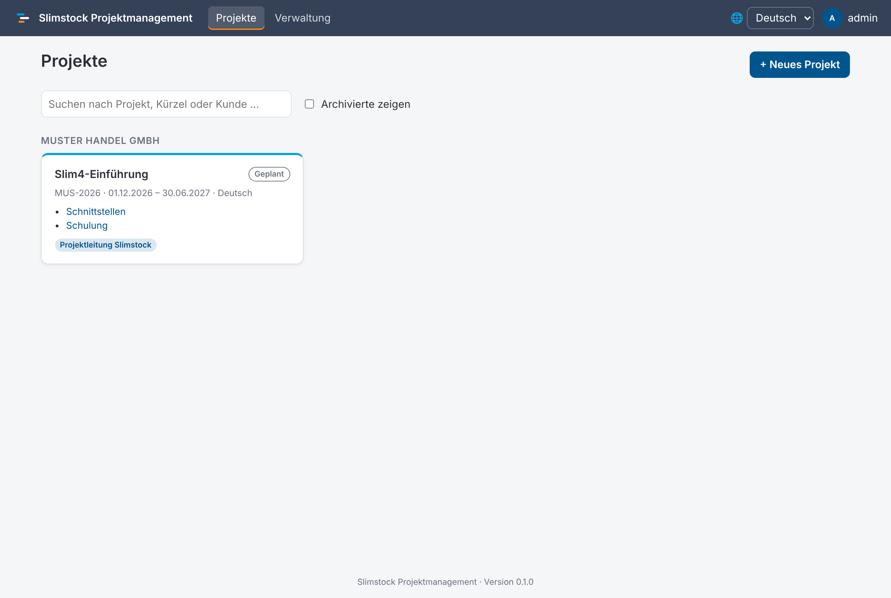
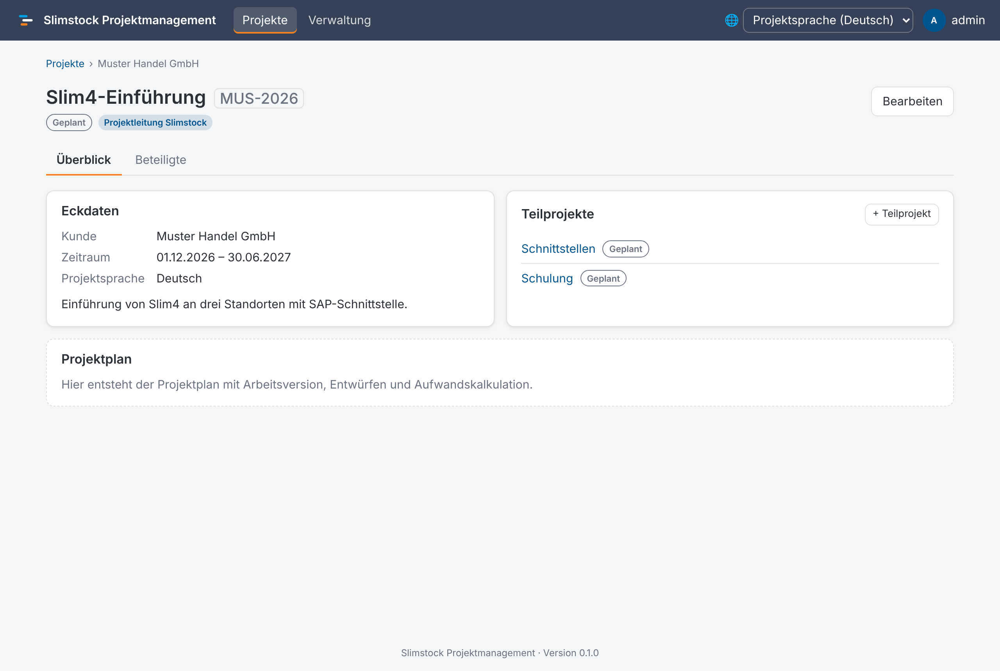
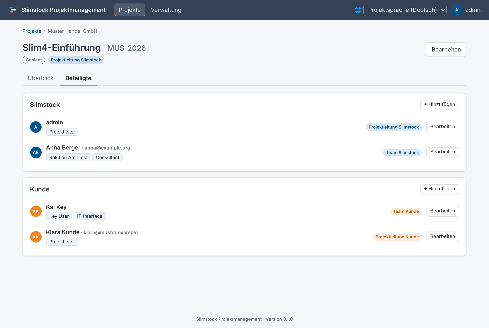
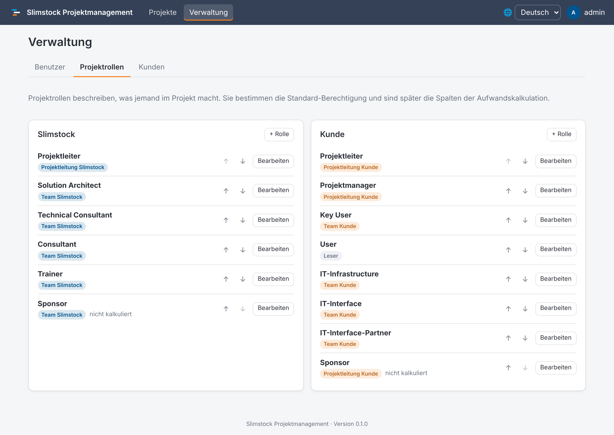

# Slimstock Projektmanagement 📋

Slimstock Projektmanagement ist dein Arbeitsplatz für Kundenprojekte: die Slim4-Einführung bei
Muster Handel mit ihren Teilprojekten Schnittstellen und Schulung, wer auf Slimstock-Seite und beim
Kunden dabei ist und was jeder darf – an einem Ort, im Browser und als App auf dem Laptop. Und weil
Projekte mit dem Kunden gemacht werden, sieht der Kunde mit: ohne Konto, ohne Passwort, über seinen
persönlichen Link.

Kurz gesagt: Schluss mit dem Projektplan als Excel-Anhang in der fünften Fassung – ein gemeinsamer
Stand, den Slimstock pflegt und der Kunde jederzeit aufrufen kann.

> **Stand: Proof of Concept, Stufe 1.** Projekte, Teilprojekte, Beteiligte mit Projektrollen und
> Berechtigungen, Benutzerverwaltung und Mehrsprachigkeit sind da. Projektplan mit Entwürfen,
> Aufwandskalkulation, Kundenzugang per Link und Taskliste folgen – siehe [PLAN.md](PLAN.md).

| Projekte | Projekt | Beteiligte | Projektrollen |
| --- | --- | --- | --- |
|  |  |  |  |

## Was Slimstock Projektmanagement für dich macht

- **Projekte mit Teilprojekten** – ein Projekt pro Kunde und Vorhaben, darunter Teilprojekte wie
  „Schnittstellen“ oder „Schulung“, bei Bedarf auch tiefer verschachtelt.
- **Wer macht was** – jede Person bekommt eine oder mehrere Projektrollen: Projektleiter, Solution
  Architect, Consultant … bei Slimstock, Projektleiter, Key User, IT-Interface … beim Kunden. Die
  Rollenliste pflegst du selbst.
- **Rechte, die sich von selbst ergeben** – aus den Rollen folgt, was jemand darf: Die
  Projektleitung Slimstock steuert alles, das Team arbeitet mit, die Projektleitung beim Kunden
  verwaltet ihre eigenen Leute, Leser lesen. Im Einzelfall stellst du es pro Person anders ein.
- **Einmal eingetragen, überall dabei** – wer im Projekt ist, ist auch in allen Teilprojekten dabei.
  Im Teilprojekt kannst du zusätzliche Rollen vergeben, etwa die Projektleitung nur für die Schulung.
- **Der Kunde bleibt für sich** – Kundenpersonen sehen nur ihre Projekte und nichts, was intern ist.
  Slimstock-Kollegen sehen nur die Projekte, in denen sie eingetragen sind.
- **Deutsch und Englisch** – jedes Projekt hat seine Sprache, und jeder kann jederzeit selbst
  umschalten. Niederländisch und Spanisch sind vorbereitet.
- **Als App installieren** – über das Browsermenü auf den Startbildschirm oder in die Taskleiste.

## Für wen ist das?

Slimstock Projektmanagement passt zu dir, wenn du

- Slim4-Einführungen und andere Kundenprojekte leitest oder darin berätst,
- den Projektstand mit dem Kunden teilen willst, ohne Dateien hin- und herzuschicken,
- klar haben willst, wer auf beiden Seiten welche Rolle hat,
- mehrsprachige Projektteams hast,
- eine Lösung willst, die auf eigenem Server läuft.

## Schnellstart mit Docker

```bash
cp .env.example .env
cp compose.example.yml compose.yml
```

In `.env` mindestens `PUBLIC_URL`, `SESSION_KEY`, `POSTGRES_PASSWORD` und `ADMIN_PASSWORD` setzen, dann:

```bash
docker compose up -d
docker compose ps
```

Beide Dienste zeigen nach kurzer Zeit „healthy“. Die App lauscht auf Port **43871**, das Image ist
`ghcr.io/doenke/slimstock-project`. Die Daten der Datenbank liegen unter
`/data/container/slimstock-project/db`.

## Ein erster Rundgang

### 1. Als Admin anmelden

Mit `ADMIN_USERNAME` und `ADMIN_PASSWORD` aus der `.env` anmelden. Die App verlangt sofort ein
eigenes Passwort (mindestens 12 Zeichen) – danach kannst du die beiden Zeilen aus der `.env` löschen.

### 2. Kollegen anlegen

**Verwaltung → Benutzer → Neuer Benutzer:** Benutzername, Name, E-Mail und ein Startpasswort. Gib das
Startpasswort auf sicherem Weg weiter; beim ersten Login wird es durch ein eigenes ersetzt. Wer Admin
ist, verwaltet Benutzer, Rollen und Kunden und sieht alle Projekte.

### 3. Projektrollen prüfen

**Verwaltung → Projektrollen:** Die üblichen Rollen sind schon da. Jede Rolle hat einen Namen je
Sprache, eine Standard-Berechtigung und die Angabe, ob sie später in der Aufwandskalkulation eine
eigene Spalte bekommt (beim Sponsor nicht). Neue Rollen hinzufügen, umbenennen, sortieren oder
deaktivieren geht jederzeit.

### 4. Projekt anlegen

**Projekte → Neues Projekt:** Kunde wählen oder neu anlegen, Name, Kürzel, Projektsprache und
Zeitraum. Du bist automatisch Projektleiter. Unter **Teilprojekt** legst du die Teilprojekte an.

### 5. Beteiligte eintragen

Im Projekt unter **Beteiligte**: Slimstock-Kollegen aus der Liste wählen, Personen beim Kunden mit
Name und E-Mail eintragen, jeweils mit ihren Rollen. Die Berechtigung ergibt sich aus den Rollen; nur
wenn es im Einzelfall anders sein soll, stellst du sie direkt ein. Über die E-Mail erkennt die App
dieselbe Kundenperson in mehreren Projekten wieder.

## Sprachen

Die Projektsprache bestimmt, was alle in diesem Projekt standardmäßig sehen. Über das 🌐-Menü oben
schaltet jeder für sich um – die Wahl bleibt gemerkt, „Projektsprache“ stellt sie zurück. Übersetzt
wird alles, was die App mitbringt (Oberfläche, Rollennamen, Datumsformate); was Menschen schreiben,
bleibt, wie es ist.

## Was die App (noch) nicht kann

- Projektplan, Entwürfe und Aufwandskalkulation kommen in den nächsten Stufen.
- Kunden können sich noch nicht anmelden – der persönliche Link pro Projekt kommt in Stufe 5.
- Kein Firmenlogin (Microsoft Entra o. Ä.) – vorerst Benutzername und Passwort.
- Keine Mails: Startpasswörter und später Links gibst du selbst weiter.

## Kleine Konfiguration, große Wirkung

| Einstellung | Wofür? |
| --- | --- |
| `PUBLIC_URL` | Adresse der App, so wie sie im Browser steht – die Subdomain wählst du frei. |
| `SESSION_KEY` | Signiert die Anmelde-Cookies (`openssl rand -base64 32`). Ändern meldet alle ab. |
| `POSTGRES_PASSWORD` | Passwort der Datenbank im Compose-Netz. |
| `ADMIN_USERNAME`, `ADMIN_PASSWORD` | Erster Admin, nur beim allerersten Start. |
| `DEFAULT_LANGUAGE` | `de` oder `en`: Sprache neuer Projekte und der Anmeldeseite. |
| `TRUSTED_PROXY` | `true` hinter einem Reverse Proxy, damit die Login-Bremse echte Adressen sieht. |
| `PORT` | Standard `43871`, innen und außen gleich. |

Alles Weitere steht in [`.env.example`](.env.example).

---

## Betriebsecke

### Reverse Proxy (z. B. Nginx Proxy Manager)

Proxy Host für die gewählte Subdomain auf `http://<host>:43871`, „Force SSL“ an. HTTPS ist Pflicht,
sonst lässt sich die App nicht installieren und das Anmelde-Cookie nicht sicher setzen.

### Wichtige Hinweise für den Betrieb

- **Backup:** die Datenbank, z. B. `docker exec slimstock-project-db pg_dump -U spm spm > backup.sql`.
- **Updates:** `docker compose pull && docker compose up -d`. Datenbank-Änderungen laufen beim Start
  von selbst.
- **Version:** unten in der App, im Healthcheck und als Image-Tag (`x.yy.zzz`).
- **Healthcheck:** `GET /healthz` – 200 mit Version, wenn auch die Datenbank antwortet, sonst 503.
  Gut für Uptime Kuma.
- **Login-Bremse:** Nach 5 Fehlversuchen ist ein Benutzername von einer Adresse 5 Minuten gesperrt,
  danach länger.
- **Umzug:** Image und Datenbank-Dump mitnehmen, `.env` anpassen – mehr braucht es nicht.

### Entwicklung

```bash
pnpm install
pnpm dev
```

Braucht eine PostgreSQL (`DATABASE_URL` in `.env`). Tests: `pnpm test` (mit `TEST_DATABASE_URL`).

## Lizenz

[MIT](LICENSE)
