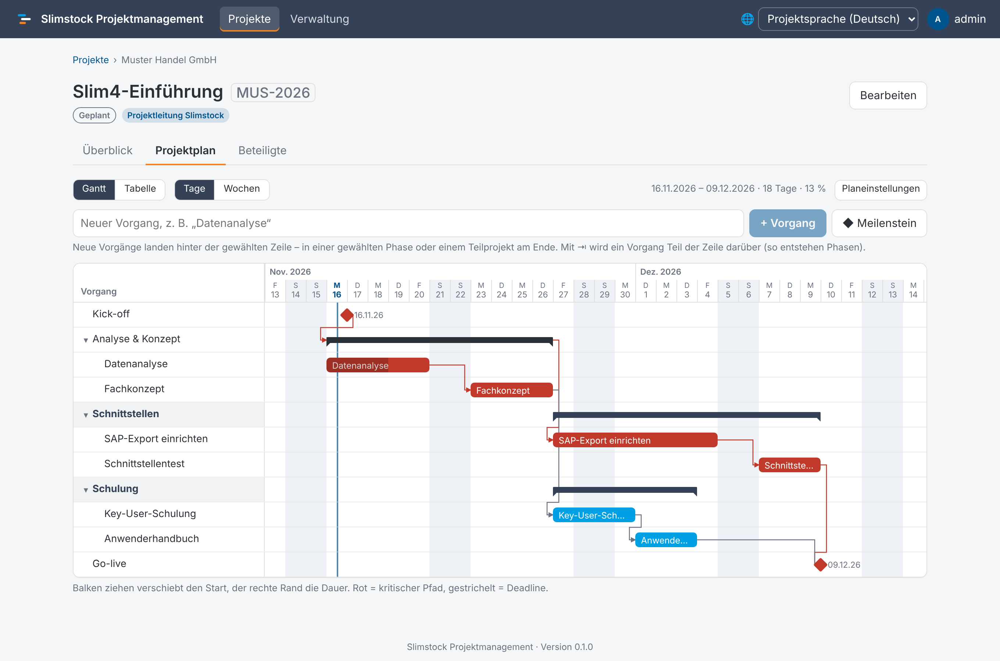
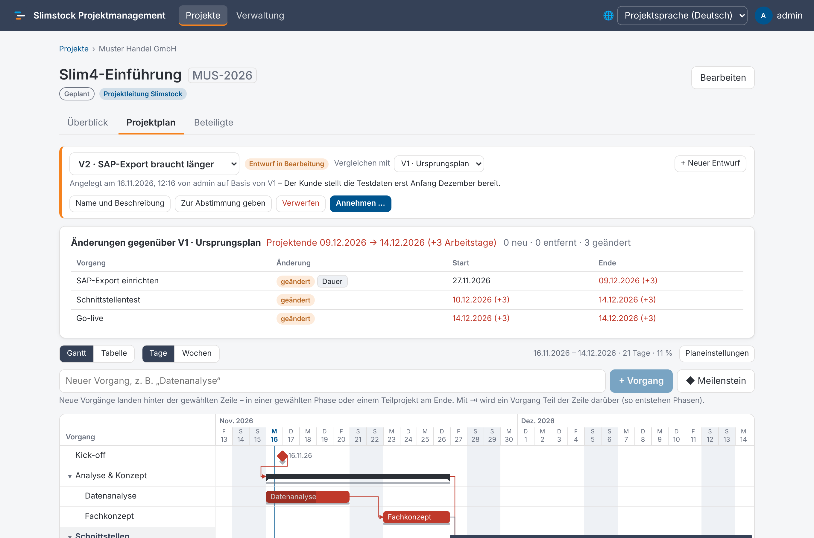
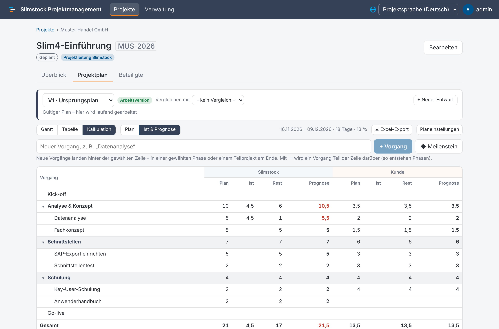
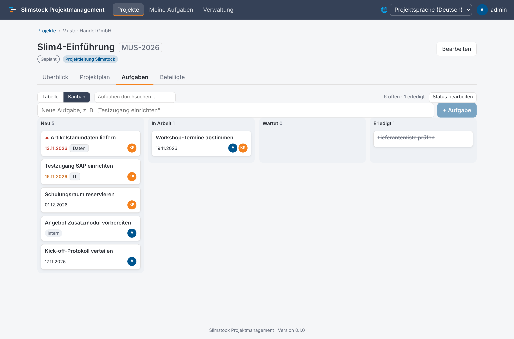
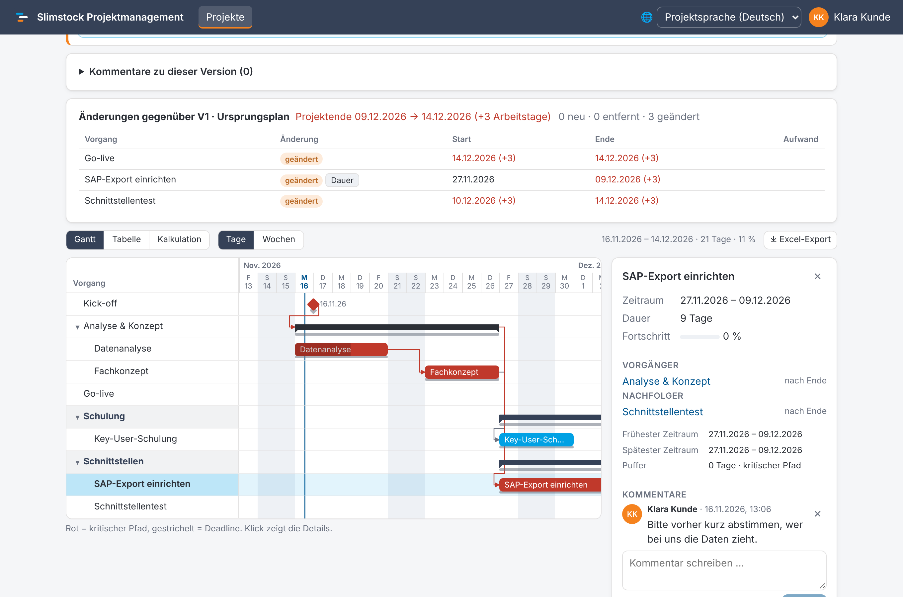

# Slimstock Projektmanagement 📋

Slimstock Projektmanagement ist dein Arbeitsplatz für Kundenprojekte: die Slim4-Einführung bei
Muster Handel mit ihren Teilprojekten Schnittstellen und Schulung, wer auf Slimstock-Seite und beim
Kunden dabei ist und was jeder darf – an einem Ort, im Browser und als App auf dem Laptop. Und weil
Projekte mit dem Kunden gemacht werden, sieht der Kunde mit: ohne Konto, ohne Passwort, über seinen
persönlichen Link.

Kurz gesagt: Schluss mit dem Projektplan als Excel-Anhang in der fünften Fassung – ein gemeinsamer
Stand, den Slimstock pflegt und der Kunde jederzeit aufrufen kann.

> **Stand: Proof of Concept, Stufe 6.** Projekte, Teilprojekte, Beteiligte mit Projektrollen und
> Berechtigungen, Benutzerverwaltung, Mehrsprachigkeit, der Projektplan (Tabelle und Gantt), Entwürfe
> mit Vergleich und Historie, die Aufwandskalkulation, der Kundenzugang per persönlichem Link mit
> Abstimmung und Kommentaren sowie die Aufgabenliste sind da – siehe [PLAN.md](PLAN.md).

| Projektplan | Entwurf im Vergleich | Kalkulation | Aufgaben | Kundensicht |
| --- | --- | --- | --- | --- |
|  |  |  |  |  |

## Was Slimstock Projektmanagement für dich macht

- **Projekte mit Teilprojekten** – ein Projekt pro Kunde und Vorhaben, darunter Teilprojekte wie
  „Schnittstellen“ oder „Schulung“, bei Bedarf auch tiefer verschachtelt.
- **Ein Projektplan für alles** – Vorgänge, Phasen und Meilensteine für das ganze Projekt, jedes
  Teilprojekt als eigener Block darin. Verknüpfungen („nach Ende“, „gleicher Start“ … mit Abstand),
  Arbeitstage, feste Termine, Deadlines – die App rechnet frühestes und spätestes Datum, Puffer und
  den kritischen Pfad aus. Als Tabelle oder als Gantt, in dem du Balken einfach ziehst.
- **Entwürfe statt Excel-Fassung 5** – so viele Entwürfe, wie du willst: „Go-live zwei Wochen
  später“, „Schulung vorziehen“. Jeder Entwurf ist eine Kopie, in der du frei planst; die
  Arbeitsversion bleibt unberührt. Ein angenommener Entwurf wird zur neuen Arbeitsversion, die alte
  wandert in die Historie – Fortschritt und Ist-Termine nimmt er dabei mit.
- **Sehen, was sich ändert** – jede Version lässt sich mit jeder anderen vergleichen: graue Balken im
  Gantt, eine Liste aller neuen, entfernten und verschobenen Vorgänge und wie sich das Projektende
  bewegt.
- **Aufwand in Tagen, nicht in Euro** – pro Vorgang trägst du die Tage je Projektrolle ein: Solution
  Architect 3, Consultant 2, Key User 2. Die App summiert über Phasen, Teilprojekte und das Projekt,
  getrennt nach Slimstock- und Kunden-Tagen – so sieht auch der Kunde, wie viel seine Leute einplanen
  müssen.
- **Ist, Rest und Prognose** – geleistete Tage bucht ihr von Hand am Vorgang (Datum, Person, Rolle,
  Notiz). Rest ist Plan minus Ist, außer du schätzt ihn selbst; die Prognose zeigt, wo ein Teilprojekt
  landet, mit Ampel gegen das Budget.
- **Festpreis oder nach Aufwand** – je Teilprojekt. Beim Festpreis bleibt das Budget fest, Mehraufwand
  zeigt die App intern rot. Wächst der Aufwand in einem Entwurf, fragt die App beim Annehmen:
  Nachtrag oder im Festpreis?
- **Excel-Export** – Plan und Aufwand, Budget und Buchungen als Excel-Datei in der Projektsprache.
- **Stand im Blick** – Fortschritt, Ist-Start und Ist-Ende je Vorgang; Phasen, Teilprojekte und das
  ganze Projekt rechnen ihren Stand daraus.
- **Offene Punkte an einem Ort** – die Aufgabenliste für alles, was zwischendurch anfällt: „Kunde
  liefert Artikelstammdaten“, „Testzugang einrichten“. Mit Status, Fälligkeit, Priorität, Bereich,
  Personen auf beiden Seiten, Links und Kommentaren – als Tabelle oder Kanban, auf Wunsch mit einem
  Vorgang im Plan verknüpft. **Meine Aufgaben** zeigt jedem, was er über alle Projekte hinweg zu tun hat.
- **Wer macht was** – jede Person bekommt eine oder mehrere Projektrollen: Projektleiter, Solution
  Architect, Consultant … bei Slimstock, Projektleiter, Key User, IT-Interface … beim Kunden. Die
  Rollenliste pflegst du selbst.
- **Rechte, die sich von selbst ergeben** – aus den Rollen folgt, was jemand darf: Die
  Projektleitung Slimstock steuert alles, das Team arbeitet mit, die Projektleitung beim Kunden
  verwaltet ihre eigenen Leute, Leser lesen. Im Einzelfall stellst du es pro Person anders ein.
- **Einmal eingetragen, überall dabei** – wer im Projekt ist, ist auch in allen Teilprojekten dabei.
  Im Teilprojekt kannst du zusätzliche Rollen vergeben, etwa die Projektleitung nur für die Schulung.
- **Der Kunde ist dabei – ohne Passwort** – jede Person beim Kunden bekommt pro Projekt einen
  persönlichen Link. Einmal geöffnet oder als Lesezeichen gespeichert, ist sie drin. Wird der Link
  weitergegeben, erneuerst du ihn mit einem Klick – der alte gilt sofort nicht mehr.
- **Du entscheidest, was der Kunde sieht** – je Version: die Arbeitsversion, ein Entwurf zur
  Abstimmung, eine alte Version. Interne Vorgänge und interne Kommentare sieht er nie.
- **Abstimmung und Kommentare** – die Projektleitung beim Kunden stimmt einem Entwurf zu oder lehnt
  mit Begründung ab; alle können am Plan und an einzelnen Vorgängen kommentieren.
- **Der Kunde bleibt für sich** – Kundenpersonen sehen nur ihre Projekte und nichts, was intern ist.
  Slimstock-Kollegen sehen nur die Projekte, in denen sie eingetragen sind.
- **Deutsch und Englisch** – jedes Projekt hat seine Sprache, und jeder kann jederzeit selbst
  umschalten. Niederländisch und Spanisch sind vorbereitet.
- **Als App installieren** – über das Browsermenü auf den Startbildschirm oder in die Taskleiste.

## Für wen ist das?

Slimstock Projektmanagement passt zu dir, wenn du

- Slim4-Einführungen und andere Kundenprojekte leitest oder darin berätst,
- den Projektstand mit dem Kunden teilen willst, ohne Dateien hin- und herzuschicken,
- klar haben willst, wer auf beiden Seiten welche Rolle hat,
- mehrsprachige Projektteams hast,
- eine Lösung willst, die auf eigenem Server läuft.

## Schnellstart mit Docker

```bash
cp .env.example .env
cp compose.example.yml compose.yml
```

In `.env` mindestens `PUBLIC_URL`, `SESSION_KEY`, `POSTGRES_PASSWORD` und `ADMIN_PASSWORD` setzen, dann:

```bash
docker compose up -d
docker compose ps
```

Beide Dienste zeigen nach kurzer Zeit „healthy“. Die App lauscht auf Port **43871**, das Image ist
`ghcr.io/doenke/slimstock-project`. Die Daten der Datenbank liegen unter
`/data/container/slimstock-project/db`.

## Ein erster Rundgang

### 1. Als Admin anmelden

Mit `ADMIN_USERNAME` und `ADMIN_PASSWORD` aus der `.env` anmelden. Die App verlangt sofort ein
eigenes Passwort (mindestens 12 Zeichen) – danach kannst du die beiden Zeilen aus der `.env` löschen.

### 2. Kollegen anlegen

**Verwaltung → Benutzer → Neuer Benutzer:** Benutzername, Name, E-Mail und ein Startpasswort. Gib das
Startpasswort auf sicherem Weg weiter; beim ersten Login wird es durch ein eigenes ersetzt. Wer Admin
ist, verwaltet Benutzer, Rollen und Kunden und sieht alle Projekte.

### 3. Projektrollen prüfen

**Verwaltung → Projektrollen:** Die üblichen Rollen sind schon da. Jede Rolle hat einen Namen je
Sprache, eine Standard-Berechtigung und die Angabe, ob sie später in der Aufwandskalkulation eine
eigene Spalte bekommt (beim Sponsor nicht). Neue Rollen hinzufügen, umbenennen, sortieren oder
deaktivieren geht jederzeit.

### 4. Projekt anlegen

**Projekte → Neues Projekt:** Kunde wählen oder neu anlegen, Name, Kürzel, Projektsprache und
Zeitraum. Du bist automatisch Projektleiter. Unter **Teilprojekt** legst du die Teilprojekte an.

### 5. Projektplan aufbauen

Im Projekt unter **Projektplan**: Vorgang eintippen, **+ Vorgang** – er landet hinter der gewählten
Zeile, in einer gewählten Phase oder einem Teilprojekt am Ende. Mit **⇥** wird ein Vorgang Teil der
Zeile darüber, so entstehen Phasen; **⇤** holt ihn wieder heraus, **↑ ↓** sortieren. Rechts in den
Details trägst du Dauer (in Arbeitstagen), feste Termine, Deadline, Vorgänger, Fortschritt und wer
dran arbeitet ein. Grau heißt berechnet, ↺ macht aus einer Vorgabe wieder eine Rechnung. Im Gantt
verschiebst du einen Balken per Ziehen, am rechten Rand änderst du die Dauer.

Unter **Planeinstellungen** legst du die Arbeitstage, den Planbeginn und den Ressourcenabgleich fest
(dann arbeitet jede Person ihre Vorgänge nacheinander ab). Auf einem Teilprojekt zeigt der Plan nur
dessen Teil; ein Haken holt den ganzen Plan dazu.

Der Plan, den du hier bearbeitest, ist die **Arbeitsversion** – der gültige Stand, in dem laufend
Fortschritt und Ist-Termine gepflegt werden.

### 6. Mit Entwürfen umplanen

Steht eine größere Änderung an, legst du oben in der Versionsleiste einen **Neuen Entwurf** an – mit
einem Namen und dem Grund („Der Kunde liefert die Testdaten später“). Im Entwurf planst du frei; die
Änderungsliste und die grauen Balken zeigen laufend, was sich gegenüber der Arbeitsversion ändert.

- **Zur Abstimmung geben** sperrt den Entwurf, damit niemand einem sich bewegenden Ziel zustimmt.
  **Zurückholen** macht ihn wieder bearbeitbar.
- **Annehmen …** zeigt vorher, was sich ändert, welche Ist-Daten aus der Arbeitsversion übernommen
  werden und welche Planänderungen in der Arbeitsversion seit Beginn des Entwurfs dabei verloren
  gingen. Danach ist der Entwurf die Arbeitsversion, die alte steht in der Historie.
- **Verwerfen** legt einen Entwurf zur Seite; er bleibt in der Liste und lässt sich wiederbeleben.
- Aus jeder Version – auch aus der Historie – lässt sich ein neuer Entwurf machen.

Entwürfe anlegen und bearbeiten darf das Slimstock-Team; zur Abstimmung geben und annehmen nur die
Projektleitung Slimstock. Der Kunde sieht Entwürfe noch nicht – das kommt mit dem Kundenzugang.

### 7. Aufwand kalkulieren und buchen

Im Projektplan auf **Kalkulation** umschalten: eine Spalte je kalkulierter Projektrolle, Slimstock links,
Kunde rechts. Tage direkt in die Zellen tippen (Vierteltage, „1,5“ geht). Phasen, Teilprojekte und die
Gesamtzeile rechnen mit. Im Detailbereich eines Vorgangs stehen die Rollen mit Aufwand; **+ Rolle**
nimmt eine weitere dazu.

- **Ist-Buchungen** im Detailbereich: Datum, Person, Rolle, Tage, Notiz. Buchungen gelten für alle
  Versionen des Plans – ein neuer Entwurf ändert nichts am Gebuchten.
- **Rest** ist automatisch Plan minus Ist; trag ihn selbst ein, wenn du es besser weißt.
- **Ist & Prognose** zeigt je Seite Plan, Ist, Rest und Prognose; darunter das **Budget je
  Teilprojekt** mit Abweichung und Ampel (Schwellen unter Planeinstellungen).
- **Abrechnung**: In der Budget-Tabelle stellt die Projektleitung je Teilprojekt *Festpreis* oder
  *nach Aufwand* ein. Festpreis in der Arbeitsversion legt das Budget sofort auf den aktuellen Plan
  fest; in einem Entwurf erst beim Annehmen. Beim Annehmen eines Entwurfs mit mehr Aufwand in einem
  Festpreis-Teil entscheidest du: **Nachtrag** (Budget wird erhöht) oder **im Festpreis** (Budget bleibt).
- **Dauer aus Aufwand** (Planeinstellungen): Vorgänge ohne eingetragene Dauer dauern so lange wie die
  Rolle mit dem meisten Aufwand, geteilt durch die eingeplanten Personen mit dieser Rolle.
- Was der **Kunde** von der Kalkulation sieht, stellst du unter Planeinstellungen ein: nichts, nur die
  Tage seiner Leute, alle Plan-Tage oder alles mit Ist und Prognose (Standard: alle Plan-Tage).
- **Excel-Export** oben rechts: Plan und Aufwand, Budget und Buchungen – genau das, was du in der App
  sehen darfst.

### 8. Aufgaben verteilen

Im Projekt unter **Aufgaben**: Titel eintippen, **+ Aufgabe** – rechts öffnen sich die Details mit
Status, Fälligkeit, Priorität, Bereich, Teilprojekt, Beschreibung, Personen, Links und Kommentaren. Eine
Aufgabe kann auf einen **Vorgang im Plan** zeigen; der Vorgang listet dann „Aufgaben dazu“.

- **Tabelle** gruppiert nach Fälligkeit (überfällig, heute, nächste 7 Tage, später, ohne Datum), Status,
  Person oder Teilprojekt. Der Haken vorne erledigt eine Aufgabe.
- **Kanban**: eine Spalte je Status plus „Erledigt“. Karten ziehen ändert den Status oder die
  Reihenfolge.
- **Status bearbeiten** (Projektleitung): eigene Status je Projekt, z. B. „Beim Kunden“, „In Test“.
- **Intern** markierte Aufgaben und interne Kommentare sieht der Kunde nicht.
- Der Kunde arbeitet mit: Seine Projektleitung legt Aufgaben an und bearbeitet alle (nicht internen),
  Key User & Co. die eigenen und die ihnen zugeordneten. Leser schauen nur zu.
- **Meine Aufgaben** oben in der Leiste: alles Offene, das dir zugeordnet ist, über alle Projekte.

### 9. Beteiligte eintragen

Im Projekt unter **Beteiligte**: Slimstock-Kollegen aus der Liste wählen, Personen beim Kunden mit
Name und E-Mail eintragen, jeweils mit ihren Rollen. Die Berechtigung ergibt sich aus den Rollen; nur
wenn es im Einzelfall anders sein soll, stellst du sie direkt ein. Über die E-Mail erkennt die App
dieselbe Kundenperson in mehreren Projekten wieder.

### 10. Den Kunden einladen

Bei jeder Person auf Kundenseite gibt es den Knopf **🔗 Link**: Er zeigt den persönlichen Link für
dieses Projekt zum **Kopieren**, **Teilen** oder **per E-Mail senden** (öffnet dein Mailprogramm mit
einem fertigen Text in der Sprache, die du gerade nutzt). Der Link läuft nicht ab; du siehst, wann er
zuletzt geöffnet wurde. **Link erneuern** macht den alten sofort ungültig und beendet offene Sitzungen.
Die Projektleitung beim Kunden kann ihren eigenen Leuten ebenfalls Links geben.

Was der Kunde im Plan sieht, entscheidest du je Version mit dem Haken **„Der Kunde sieht diese
Version“** in der Versionsleiste. **Zur Abstimmung geben** zeigt einen Entwurf automatisch; die
Projektleitung beim Kunden sieht ihn mit Änderungsliste und kann **zustimmen** oder **ablehnen** (mit
Begründung). Holst du den Entwurf zurück, verschwindet er beim Kunden und bisherige Zustimmungen
verfallen. Beim Annehmen zeigt die App an, ob der Kunde zugestimmt hat – annehmen kannst du trotzdem.

Kommentare gibt es zur ganzen Version und an jedem Vorgang. Slimstock kann Kommentare als **intern**
markieren; die sieht der Kunde nicht.

## Sprachen

Die Projektsprache bestimmt, was alle in diesem Projekt standardmäßig sehen. Über das 🌐-Menü oben
schaltet jeder für sich um – die Wahl bleibt gemerkt, „Projektsprache“ stellt sie zurück. Übersetzt
wird alles, was die App mitbringt (Oberfläche, Rollennamen, Datumsformate); was Menschen schreiben,
bleibt, wie es ist.

## Was die App (noch) nicht kann

- Die App verschickt selbst keine Mails – den Link teilst du per Kopieren, Teilen oder über dein
  Mailprogramm.
- Wer den Link hat, ist drin – wie bei einem geteilten Dokument. Gib ihn nur der Person selbst.
- Aufgaben haben noch keine Dateianhänge und keine Erinnerungs-Mails; Links auf Dateiablagen gehen.
- Keine Preise und keine Euro – bewusst. Ist-Zeiten kommen noch nicht aus einer Zeiterfassung.
- Änderungen, die in der Arbeitsversion gemacht wurden, während ein Entwurf entstand, lassen sich beim
  Annehmen noch nicht einzeln übernehmen – die App zeigt sie nur an.
- Der Plan aktualisiert sich nicht live: Was ein Kollege gleichzeitig ändert, siehst du nach dem
  nächsten Neuladen. Überschreibt ihr euch, merkt die App das und lädt neu.
- Keine Feiertage im Arbeitskalender, kein Import aus MS Project.
- Kunden können sich noch nicht anmelden – der persönliche Link pro Projekt kommt in Stufe 5.
- Kein Firmenlogin (Microsoft Entra o. Ä.) – vorerst Benutzername und Passwort.
- Keine Mails: Startpasswörter und später Links gibst du selbst weiter.

## Kleine Konfiguration, große Wirkung

| Einstellung | Wofür? |
| --- | --- |
| `PUBLIC_URL` | Adresse der App, so wie sie im Browser steht – die Subdomain wählst du frei. |
| `SESSION_KEY` | Signiert die Anmelde-Cookies (`openssl rand -base64 32`). Ändern meldet alle ab. |
| `LINK_KEY` | Optional: verschlüsselt die Kunden-Links in der Datenbank. Leer = aus `SESSION_KEY` abgeleitet. Ändern macht gespeicherte Links unlesbar (sie lassen sich dann nur erneuern). |
| `POSTGRES_PASSWORD` | Passwort der Datenbank im Compose-Netz. |
| `ADMIN_USERNAME`, `ADMIN_PASSWORD` | Erster Admin, nur beim allerersten Start. |
| `DEFAULT_LANGUAGE` | `de` oder `en`: Sprache neuer Projekte und der Anmeldeseite. |
| `TRUSTED_PROXY` | `true` hinter einem Reverse Proxy, damit die Login-Bremse echte Adressen sieht. |
| `PORT` | Standard `43871`, innen und außen gleich. |

Alles Weitere steht in [`.env.example`](.env.example).

---

## Betriebsecke

### Reverse Proxy (z. B. Nginx Proxy Manager)

Proxy Host für die gewählte Subdomain auf `http://<host>:43871`, „Force SSL“ an. HTTPS ist Pflicht,
sonst lässt sich die App nicht installieren und das Anmelde-Cookie nicht sicher setzen.

### Wichtige Hinweise für den Betrieb

- **Backup:** die Datenbank, z. B. `docker exec slimstock-project-db pg_dump -U spm spm > backup.sql`.
- **Updates:** `docker compose pull && docker compose up -d`. Datenbank-Änderungen laufen beim Start
  von selbst.
- **Version:** unten in der App, im Healthcheck und als Image-Tag (`x.yy.zzz`).
- **Healthcheck:** `GET /healthz` – 200 mit Version, wenn auch die Datenbank antwortet, sonst 503.
  Gut für Uptime Kuma.
- **Login-Bremse:** Nach 5 Fehlversuchen ist ein Benutzername von einer Adresse 5 Minuten gesperrt,
  danach länger.
- **Umzug:** Image und Datenbank-Dump mitnehmen, `.env` anpassen – mehr braucht es nicht.

### Entwicklung

```bash
pnpm install
pnpm dev
```

Braucht eine PostgreSQL (`DATABASE_URL` in `.env`). Tests: `pnpm test` (mit `TEST_DATABASE_URL`).

## Lizenz

[MIT](LICENSE)
